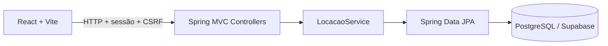

# Locar — Sistema de Aluguel de Carros


Projeto individual do Laboratório 02 de Desenvolvimento e Integração de Aplicações Web, Engenharia de Software — PUC Minas.

**Autor:** Brayan Mendes de Carvalho.

**Professor:** João Paulo Carneiro Aramuni.

## Status

Protótipo completo publicado: back-end, interface web e modelagem. O sistema funciona no perfil de demonstração local. A conexão e a validação na instância real do Supabase são a pendência para concluir a integração do banco exigido pelo laboratório.

## Sobre o projeto

A Locar permite que clientes solicitem, consultem, alterem e cancelem pedidos de aluguel. Empresas e bancos avaliam os pedidos financeiramente e emitem contratos após aprovação. Um banco pode associar crédito ao contrato.

## Funcionalidades

- Cadastro de clientes e login obrigatório com usuário e senha.
- Cadastro com RG, CPF, nome, endereço, profissão e até três empregos/rendimentos.
- Catálogo de 24 veículos com matrícula, ano, marca, modelo, placa e fotos online com créditos.
- Criação, consulta, alteração e cancelamento de pedidos.
- Avaliação financeira por agentes com parecer obrigatório.
- Contratos com propriedade em nome de cliente, empresa ou banco.
- Crédito opcional concedido pelo banco autenticado.
- Administração de usuários e cadastro de empresas e bancos.
- Controle de acesso por perfil, sessão HTTP, senhas BCrypt e proteção CSRF.

Alterações em pedidos abertos exigem nova análise. A emissão de contratos bloqueia períodos sobrepostos para o mesmo veículo.

## Tecnologias

| Camada | Tecnologia |
| --- | --- |
| Linguagem | Java — JDK 25 |
| Back-end | Spring Boot 4.0.9, Spring MVC e Spring Security |
| Build | Apache Maven |
| Front-end | React 19, Vite 7 e CSS |
| Persistência | Spring Data JPA, Hibernate e Flyway |
| Banco exigido na entrega | Supabase PostgreSQL |
| Demonstração local | H2 em modo PostgreSQL |

## Arquitetura e modelagem

Arquitetura MVC com interface React, controllers REST, camada de serviços e repositórios JPA. Dois subsistemas lógicos: apresentação web e gestão de pedidos e contratos.



- [Requisitos, histórias e regras de negócio](docs/requisitos.md)
- [Casos de uso, classes e pacotes](docs/modelagem/v1/README.md)
- [Histórico da modelagem](docs/modelagem/CHANGELOG.md)
- [Endpoints e permissões da API](docs/api.md)

## Instalação e execução

Pré-requisitos: **JDK 25**, **Maven 3.9+**, **Node.js 22.12+** e npm.

Em dois terminais, a partir da pasta do projeto:

**Back-end:**

```powershell
cd backend
mvn spring-boot:run
```

**Front-end:**

```powershell
cd frontend
npm ci
npm run dev
```

Acesse **http://127.0.0.1:5173**. A API usa a porta **8080**, acessada pelo proxy `/api` do Vite. Use `Ctrl+C` nos dois terminais para parar.

O perfil padrão `demo` cria o banco local em `backend/.data/`, as contas e o catálogo na primeira execução. Os dados do catálogo são fictícios para uso acadêmico.

### Contas de demonstração

| Usuário | Senha | Perfil |
| --- | --- | --- |
| admin | admin | Administrador |
| cliente | Demo@12345 | Cliente |
| empresa | Demo@12345 | Empresa agente |
| banco | Demo@12345 | Banco agente |

Essas contas são criadas apenas no perfil de demonstração. Novos clientes podem se cadastrar na tela de entrada.

### Supabase

O perfil `supabase` lê `DB_URL`, `DB_USER` e `DB_PASSWORD` do ambiente. O esquema é criado pelo Flyway e validado pelo Hibernate. Não há credenciais reais no repositório.

Veja [configuração do Supabase](docs/supabase.md). A execução no H2 não substitui a validação no PostgreSQL real.

### Build

```powershell
cd backend
mvn package
cd ../frontend
npm run build
```

Saídas: `backend/target/locar-0.1.0.jar` e `frontend/dist/`. O comando `npm run preview` pré-visualiza o build estático; para o fluxo integrado local, use `npm run dev` e a API.

## Estrutura

- `backend/src/main/java/br/com/locar/`: configurações, controllers, entidades, repositórios e serviços.
- `backend/src/main/resources/`: perfis de execução, migrações SQL e catálogo de veículos.
- `frontend/src/`: telas React, cliente da API e estilos.
- `frontend/public/`: identidade visual e ilustrações.
- `docs/`: requisitos, API, configuração do banco e modelos UML.

## Fotos e limites

As fotos são carregadas por URLs externas do Wikimedia Commons. Cada veículo registra fonte, autor e licença, acessíveis nos cards. As fotos são ilustrativas e podem mostrar outra versão ou ano; em caso de falha há uma alternativa visual.

O protótipo não realiza pagamento, assinatura eletrônica ou integração bancária real. Crédito representa o registro acadêmico das condições concedidas pelo agente bancário.

## Validação

O back-end passou por 34 verificações HTTP em H2 isolado, cobrindo autenticação, permissões, cadastros, pedidos, contratos e crédito. A interface foi verificada no Chrome em desktop e celular, e seu build foi validado. A conexão real com o Supabase ainda será testada.

## Autor e referências

[Brayan Mendes de Carvalho](https://github.com/BrayanMCarvalho).

README adaptado do [template da disciplina](https://github.com/joaopauloaramuni/desenvolvimento-e-integracao-de-aplicacoes-web/blob/main/TEMPLATES/template_README.md).

- [Spring Boot](https://docs.spring.io/spring-boot/4.0/)
- [React](https://react.dev/)
- [Vite](https://vite.dev/guide/)
- [Supabase](https://supabase.com/docs)
