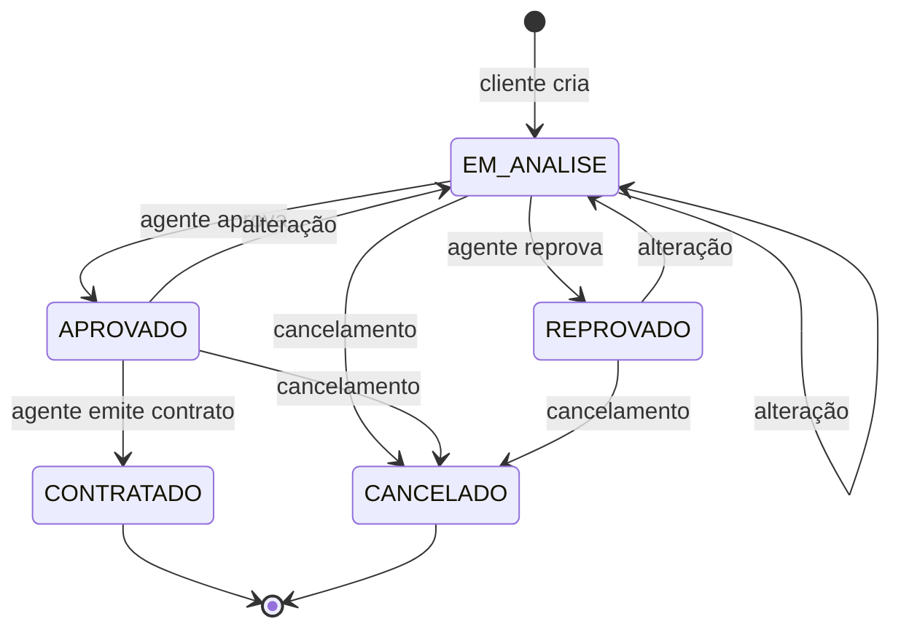

# Requisitos e decisões

Fonte: PDF do Laboratório 02 — Sistema de Aluguel de Carros, professor João Paulo Carneiro Aramuni. Os requisitos foram interpretados como especificação do trabalho; o desenvolvimento e as decisões de escopo seguem os pedidos do usuário.

## Histórias e critérios de aceitação

| ID | História | Aceitação | Implementação |
| --- | --- | --- | --- |
| HU01 | Como visitante, quero me cadastrar para utilizar o sistema. | Usuário único, senha com no mínimo oito caracteres, identificação do cliente completa; cadastro público sempre cria CLIENTE. | `Auth`, `LocacaoService.register` |
| HU02 | Como usuário, quero fazer login para acessar meus dados. | Rotas de negócio retornam 401 sem sessão; login diferencia perfis e logout invalida a sessão. | Spring Security, `/api/auth` |
| HU03 | Como cliente, quero consultar, editar e excluir meu cadastro. | Acesso apenas ao próprio cadastro; até três empregos; exclusão permitida apenas sem histórico. | `/api/clientes`, `ClientFields` |
| HU04 | Como cliente, quero escolher um veículo e solicitar aluguel. | Datas válidas, identificação do veículo e total calculado pelo servidor; status EM_ANALISE. | `/api/automoveis`, `/api/pedidos`, `OrderForm` |
| HU05 | Como cliente, quero acompanhar o status dos meus pedidos. | Cliente vê somente seus próprios pedidos e pareceres. | Listagem e detalhe de pedidos |
| HU06 | Como cliente, quero alterar e cancelar pedidos. | Alteração reabre análise; cancelamento encerra pedido; contratos e cancelados não podem ser alterados. | `update`, `cancel` |
| HU07 | Como agente, quero alterar e avaliar pedidos. | Empresa/banco consultam os pedidos, modificam dados e registram parecer obrigatório. | `evaluate`, `EvaluationForm` |
| HU08 | Como agente, quero emitir contrato após aprovação. | Apenas APROVADO; registra propriedade de cliente/empresa/banco; não admite sobreposição no mesmo veículo. | `contract`, `ContractForm` |
| HU09 | Como banco, quero associar crédito ao contrato de aluguel. | Banco autenticado é o concedente; crédito positivo, até o valor do aluguel e com 1–120 parcelas. | `Contrato.bancoId`, `valorCredito`, `parcelas` |
| HU10 | Como administrador, quero cadastrar agentes e consultar usuários. | Somente ADMIN acessa o painel; sem exposição de senhas; perfil público não é promovido. | `/api/admin` |
| HU11 | Como usuário, quero visualizar fotos dos veículos. | Catálogo de 24 carros, URLs externas, créditos e substituto quando a foto falha. | `catalogo.json`, `CarImage` |

## Regras de negócio

- RB01: login obrigatório para qualquer página de negócio, inclusive o catálogo, conforme enunciado.
- RB02: CPF é único e armazenado apenas com seus 11 dígitos; a validação atual é de formato, sem verificação de dígitos verificadores.
- RB03: zero a três vínculos empregatícios por cliente; renda não negativa.
- RB04: retirada hoje ou no futuro, devolução posterior e período até 365 dias. A cobrança considera dias corridos entre as datas, sem contar novamente a devolução.
- RB05: preços do catálogo são fictícios; o cliente não determina o total no pedido.
- RB06: EM_ANALISE pode ser APROVADO ou REPROVADO por agente; mudanças em qualquer pedido aberto devolvem a EM_ANALISE e limpam o parecer anterior.
- RB07: EM_ANALISE, APROVADO e REPROVADO podem ser cancelados. CANCELADO e CONTRATADO são terminais nesta versão.
- RB08: somente agentes ou administrador emitem contratos. Crédito exige especificamente o perfil BANCO; admin não concede crédito em nome de banco.
- RB09: uma emissão por pedido, com proteção de concorrência e contra sobreposição por automóvel. A devolução de um contrato pode coincidir com a retirada de outro.
- RB10: histórico financeiro/contratual é preservado; cadastro com pedido associado não é excluído.
- RB11: cadastro público nunca cria agente/admin. Admin provisiona agentes. Os quatro perfis usam o mesmo login com suas permissões no servidor.

## Máquina de estados

## Decisões e limites

- Escopo de carros em geral nesta primeira versão. Localiza serve de referência de navegação; identidade e código são próprios.
- Supabase PostgreSQL é o banco da entrega; perfil H2 facilita demonstração sem credenciais. Nenhum teste com uma conta real do Supabase foi executado sem as credenciais.
- Crédito está no registro `Contrato`, opcional e vinculado ao banco; não representa integração bancária real nem cobrança.
- Usuários e papéis são modelados por enum para evitar subclasses com dados repetidos; cliente tem cadastro separado com o mesmo identificador do usuário.
- Identificadores de cliente, agente e banco são chaves estrangeiras; `Pedido.automovel` usa associação JPA. Os diagramas mostram a relação de domínio e indicam as referências por ID.
- Datas atuais seguem o relógio do servidor; ao publicar para o Brasil, configure o servidor com `America/Sao_Paulo`.
- A matrícula é o identificador interno do carro. Não é tratada como placa.
- As fotos externas são ilustrativas e podem mostrar outra versão/ano; origem e licença acompanham cada veículo.
- Não há pagamento, assinatura eletrônica, recuperação de senha, documento PDF ou auditoria de todas as avaliações nesta etapa.

## Entrega acadêmica pendente de ação da equipe

Conectar o ambiente real do Supabase, preencher os integrantes e URL do repositório, publicar os arquivos no GitHub e registrar os feedbacks do professor com novas versões da modelagem. A versão v1 corresponde ao código atual; não foram inventadas versões anteriores.
